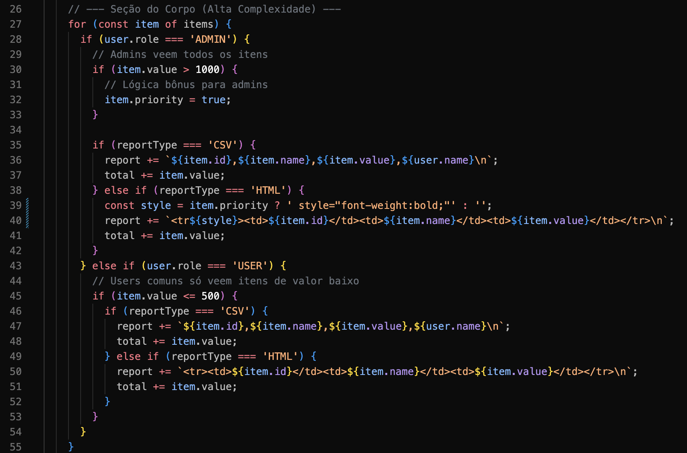

# Smells Identificados
## generateReport é um método longo
- Ele tem 57 linhas originalmente.

## Seção do Corpo tem muitos if/else e Números Mágicos 
- A seção do corpo tem complexidade ciclomática enorme.

## Seção do Corpo tem Efeito colateral no parâmetro

# Comparação com o ESLint (Etapa 4)
Resultado de `npx eslint src/` no código original:
- `11:3 sonarjs/cognitive-complexity`: complexidade cognitiva 27 em `generateReport`.
- `43:14 sonarjs/no-collapsible-if`: `if` aninhado em `else if (user.role === 'USER')` que poderia ser unido.

| Problema | Análise manual | ESLint |
| --- | --- | --- |
| Muitos if/else aninhados | Sim | Sim, e com medida (27) |
| `if` que pode ser unido (linha 43) | Não | Sim |
| Método longo | Sim | Não |
| Números mágicos (1000 e 500) | Sim | Não |
| Efeito colateral em `item.priority` | Sim | Não |
| Lógica duplicada (linhas 36-37 e 47-48) | Não | Não |

- A ferramenta transformou a impressão de "código complexo" em um número comparável e encontrou o `if` da linha 43, que passou na leitura manual.
- A leitura manual encontrou problemas de design que as regras ativas não cobrem.
- A duplicação não foi apontada por nenhuma das regras: `no-duplicated-branches` compara ramos da mesma cadeia de `if` e `no-identical-functions` compara funções inteiras.